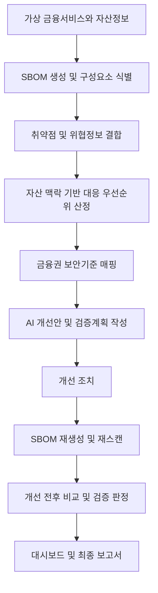

# 금융권 특화 SBOM 기반 소프트웨어 공급망 위험평가 및 개선 검증 플랫폼

가상의 금융사를 대상으로 SBOM, 취약점·공급망 위협정보, 금융서비스 자산정보를 결합하여 대응 우선순위를 산정하는 프로젝트이다. 금융권 보안기준을 참고해 개선방안을 제시하고, 조치 후 재검증을 통해 실제 개선 효과까지 확인하는 컨설팅 지원 플랫폼을 목표로 한다.

> 현재는 디렉터리 구조와 빈 파일을 구성한 설계 단계이다. 아래 기능은 구현 목표이며, API·분석 엔진·대시보드·실습환경은 아직 실행 가능한 상태가 아니다.

기획 기준: [프로젝트 Notion 문서](https://app.notion.com/p/SBOM-3e24a9a6169880f6bc91dd3d61a376ac)

## 프로젝트 방향

- SBOM의 구성요소와 버전을 기준으로 알려진 취약점과 공급망 정보를 연결한다.
- 운영 환경, 인터넷 노출, 금융업무 중요도, 신용정보 처리 여부를 함께 고려한다.
- 설명 가능한 규칙으로 대응 우선순위인 `P1`~`P4`를 계산한다.
- AI는 확인된 분석 결과를 해석하고 기술적·관리적 개선안과 검증방법을 작성한다.
- 개선 조치 이후 SBOM, 재스캔 결과, 서비스 정상동작 증적을 비교한다.
- 금융권 보안기준은 컨설팅의 근거로 활용하며, 최종 판단과 승인은 사람이 수행한다.

## 전체 흐름



`Discover -> Analyze -> Prioritize -> Recommend -> Remediate -> Verify -> Report`

## 주요 기능 계획

| 영역 | 역할 | 디렉터리 |
| --- | --- | --- |
| SBOM | CycloneDX 기반 구성요소·버전·PURL·의존성 식별 및 전후 비교 | `core/sbom/` |
| 취약점 정보 | CVE·CVSS·CWE·CISA KEV 매칭, EOL·패치 정보 확장 | `core/vulnerability/` |
| 자산 맥락 | 금융서비스와 자산 연결, 운영 여부·외부 노출·중요도·신용정보 처리 관리 | `core/assets/` |
| 대응 우선순위 | 규칙 기반 점수 및 P1~P4 산정, 계산 근거 제공 | `core/risk/` |
| 보안기준 매핑 | 발견사항과 기술적·관리적 통제항목 연결 | `core/compliance/` |
| AI 컨설팅 | 영향 설명, 개선안, 검증방법, 보고서 초안 작성 | `core/consulting/` |
| 개선 검증 | SBOM·취약점·기능 점검 결과 비교 및 검증 상태 관리 | `core/verification/` |
| API·대시보드 | 자산·분석 결과·조치 상태 조회 및 개선 전후 비교 | `app/` |

### 대응 우선순위

CVSS는 취약점 자체의 기술적 심각도이다. 본 프로젝트의 **Remediation Priority**는 여기에 금융서비스 맥락을 더한 대응 우선순위로, CVSS와 구분한다.

CVSS, KEV 등록 여부, 운영 환경, 인터넷 노출, 금융업무 중요도, 패치 지연 기간 등을 규칙 기반으로 조합한다. EOL 정보 연계는 확장 범위로 둔다. 기획 문서의 가중치는 예시이며, 최종 가중치와 등급 경계는 구현 단계에서 정의하고 검증한다.

| 등급 | 의미 |
| --- | --- |
| P1 | 최우선 대응 |
| P2 | 높은 대응 우선순위 |
| P3 | 중간 대응 우선순위 |
| P4 | 낮은 대응 우선순위 |

### AI와 보안기준의 역할

취약점 매칭과 우선순위 계산은 자동화 도구와 규칙 기반 엔진이 담당한다. AI에는 확인된 데이터와 계산 근거를 전달하여 영향 설명, 기술적·관리적 개선안, 검증방법을 작성하게 한다.

전자금융기반시설 취약점 분석·평가 기준, ISMS-P, 금융분야 오픈소스 활용·관리 관련 가이드를 참고 대상으로 삼는다. 통제항목의 출처와 버전을 관리하며, 매핑 결과를 모든 규정의 준수 여부에 대한 자동 판정으로 사용하지 않는다.

### 개선 검증

점수 하락만으로 조치 성공을 판정하지 않는다. 변경된 구성요소·버전, CVE 재매칭, 재스캔 결과, 서비스 기능 점검을 증적으로 활용한다. 관리적 조치는 승인 기록이나 절차 등 이행 증적을 확인한다.

```text
Open -> Recommendation Created -> Remediation Applied
     -> Verification In Progress -> Verification Passed / Verification Failed
```

대시보드에서는 취약 구성요소, 심각한 CVE, KEV, P1/P2 건수, 검증 완료 조치 등을 개선 전후로 비교할 계획이다. EOL 현황은 확장 범위에 포함한다.

## MVP 및 확장 범위

### MVP

- 가상 금융서비스 3개 이상과 Asset Inventory 구성
- SBOM 생성, 구성요소·버전 추출, CVE·CVSS 매칭 및 CISA KEV 확인
- 자산 맥락을 결합한 P1~P4 대응 우선순위 산정
- 금융권 보안기준 매핑, AI 개선안 및 검증계획 생성
- 개선 조치 후 SBOM 재생성·재스캔, 검증 성공·실패 판정
- 개선 전후 결과를 비교하는 대시보드

### 확장

EOL 정보, Vendor Mapping, Historical KEV Replay, 악성 패키지·Typosquatting 분석, 의존성 변경 탐지, AI 추천 의존성 검증, CI/CD 공급망 변경 분석, 보안기준 매핑 고도화, 중복 통제항목 통합, PDF 보고서 생성을 고려한다.

기획의 실습 구성에는 EOL이 포함되어 있지만 MVP 목록에서는 확장으로 분류되어 있다. 저장소에는 실습용 자리를 마련하고 구현 순서는 MVP 이후로 구분한다.

## 실습 및 시연 계획

분석 플랫폼과 취약 실습환경을 한 저장소에서 분리해 관리한다. 실습은 격리된 로컬 환경에서 수행하며, 취약 상태와 개선 상태의 구성정보 및 점검 결과를 비교한다.

| 실습 디렉터리 | 목적 |
| --- | --- |
| `labs/log4shell/` | 대표적인 의존성 취약점의 발견부터 패치 후 검증까지 비교 |
| `labs/struts2/` | 장기간 미패치 구성요소와 대응 우선순위 분석 |
| `labs/snakeyaml/` | 간접 의존성 식별과 개선 전후 비교 |
| `labs/eol_component/` | 지원 종료 소프트웨어의 수명주기 위험 분석, 확장 범위 |

각 실습의 `vulnerable/`와 `patched/`는 비교 대상의 위치이며 현재 구현은 비어 있다.

시연 정의는 `scenarios/`에서 관리한다. `scenario_01_patch_delay.yaml`은 발견·개선·검증의 기본 흐름, `scenario_02_kev_replay.yaml`은 과거 KEV 정보 변화에 따른 재평가, `scenario_03_vendor_risk.yaml`은 공급업체 관계를 통한 영향범위 분석을 위한 자리이다. 뒤의 두 시나리오는 확장 범위이다.

## 디렉터리 구조

```text
1q2w3e4r/
├── app/                       # 분석 플랫폼 진입점
│   ├── api/                   # Flask API
│   ├── config/                # 환경 변수 및 로깅 설정
│   └── dashboard/             # Streamlit 화면, pages/, components/
├── core/                      # 분석 도메인 로직
│   ├── sbom/                  # 생성, 파싱, 정규화, 비교
│   ├── vulnerability/         # 취약점 및 위협정보 매칭
│   ├── assets/                # 자산과 금융서비스 맥락
│   ├── risk/                  # 규칙 기반 대응 우선순위
│   ├── compliance/            # 보안기준 매핑 및 standards/
│   ├── consulting/            # AI 개선안과 보고서
│   └── verification/          # 개선 결과 검증
├── database/                  # 연결, models/, repositories/, migrations/
├── labs/                      # 분석 플랫폼과 분리된 실습환경
│   ├── log4shell/
│   ├── struts2/
│   ├── snakeyaml/
│   └── eol_component/
├── scenarios/                 # 시연 시나리오 정의
├── data/
│   ├── assets/                # 가상 자산 데이터
│   ├── sbom/                  # before/, after/
│   ├── threat_intel/          # 위협정보 입력 및 캐시
│   └── seed/                  # 초기 샘플 데이터
├── scripts/                   # 수집, 분석, 검증 CLI 자리
├── tests/                     # unit/, integration/, fixtures/
├── reports/                   # 생성 보고서
├── docs/                      # 설계 문서 자리
├── .github/                   # 협업 템플릿 및 워크플로 자리
├── .env.example               # 비밀값 없는 환경 변수 예제
├── .gitignore
├── requirements.txt           # 의존성 목록 자리
├── pyproject.toml             # 프로젝트 설정 자리
└── README.md
```

각 디렉터리의 README에서 세부 역할을 설명한다. `database/models/`는 데이터베이스 도메인 모델을 위한 위치이다.

## 기술 구성 및 준비 상태

| 구분 | 계획 |
| --- | --- |
| 분석 플랫폼 | Python, Flask API, Streamlit 대시보드 |
| SBOM | CycloneDX를 기본 형식으로 고려, Syft 등 기존 생성 도구 활용 검토 |
| 위험평가 | 설명 가능한 규칙 기반 엔진 |
| AI 컨설팅 | OpenAI API로 검증된 분석 결과 해석 및 문서 생성 |
| 저장소 | 도메인 모델과 저장소 계층 분리, DB 제품 및 라이브러리 미확정 |
| 실습환경 | 플랫폼과 분리된 Docker Compose 구성 계획 |

현재 의존성 목록, 실행 진입점, Compose 파일, 테스트 및 CI 설정은 빈 파일이다. 설치·실행 명령과 지원 버전은 구현 후 문서화한다.

API 키 등 실제 비밀값은 로컬 `.env`에만 등록한다. `.env.example`에는 변수명과 공개 가능한 기본값만 둔다. 기존 예제의 `MODEL_PATH`는 이전 프로젝트에서 남은 항목으로 현재 규칙 기반 MVP에서 사용하지 않는다.

## 개발 컨벤션

- Python 코드는 PEP 8을 따른다.
- 디렉터리·Python 파일·변수·함수는 `snake_case`, 클래스는 `PascalCase`, 상수·환경 변수는 `UPPER_SNAKE_CASE`를 사용한다.
- 파일명 예: `asset_service.py`, `kev_client.py`, `report_generator.py`, `verify_remediation.py`.
- 현재 대시보드에는 `Home.py`, `01_Assets.py` 등 초기 파일명이 남아 있다. 새 파일에는 위 규칙을 적용하며, 기존 이름 정리는 별도 변경으로 진행한다.
- import는 표준 라이브러리, 외부 라이브러리, 프로젝트 모듈 순으로 구분한다.
- 주석은 규칙의 근거나 판단 이유를 설명한다.
- 요청·화면 처리는 `app/`, 분석은 `core/`, 영속성 처리는 `database/`에 둔다.
- 분석 입력, 적용 규칙, 외부 데이터 기준시점, 계산 근거, 검증 증적을 추적할 수 있도록 설계한다.

## Git 브랜치 전략

경량 Git Flow를 사용하며 별도 `release` 브랜치는 운영하지 않는다.

| 브랜치 | 역할 |
| --- | --- |
| `main` | 최종 배포 및 발표 버전 |
| `develop` | 기능 통합 |
| `feat/*` | `develop`에서 분기하는 기능 개발 |
| `hotfix/*` | 배포 후 긴급 수정이 필요할 때 생성 |

기능 개발은 `feat/*`에서 진행하고 PR로 `develop`에 병합한다. 최종 버전은 `develop`에서 `main`으로 병합한다. 긴급 수정은 `main`에서 분기하여 수정 후 `main`과 `develop` 모두에 반영한다.

이 프로젝트에 맞는 기능 브랜치명 예시는 `feat/sbom-parser`, `feat/risk-engine`, `feat/verification`, `feat/dashboard`, `feat/openai-report`이다. 기존에 만든 `feat/log-parser`, `feat/ml-model`은 초기 컨벤션을 따른 이름이며, 이 문서 수정에서 실제 브랜치를 변경하지는 않는다.

## 커밋 컨벤션

커밋 제목은 `<type>: <한글 설명>` 형식을 사용한다. 병합 커밋에도 같은 규칙을 적용한다.

| Type | 용도 |
| --- | --- |
| `feat` | 새로운 기능 |
| `fix` | 버그 수정 |
| `hotfix` | 긴급 수정 |
| `refactor` | 리팩토링 |
| `style` | 코드 스타일 및 UI |
| `docs` | 문서 |
| `test` | 테스트 |
| `comment` | 주석 |
| `rename` | 파일·폴더 이름 변경 |
| `remove` | 파일 삭제 |
| `chore` | 빌드·환경설정 등 기타 작업 |

```text
feat: CycloneDX SBOM 파서 구현
feat: 금융서비스 대응 우선순위 계산 추가
fix: 구성요소 버전 매칭 오류 수정
docs: SBOM 프로젝트 기획에 맞게 README 수정
test: 개선 전후 검증 결과 비교 테스트 추가
```

현재 저장소에 `commit-msg` Hook은 구현되어 있지 않다. 커밋 작성과 PR 리뷰에서 규칙을 확인한다.

## 협업 및 파일 관리

- 기능 개발 전 Issue를 만들고 기능 단위로 커밋한다.
- 병합 전 PR을 생성하고 공통 코드 변경은 팀원과 공유한다.
- 충돌은 관련 작업자와 협의하여 해결한다.
- 설계·동작 변경에 영향을 받는 README와 문서를 함께 수정한다.
- 실제 API 키, 운영 데이터, 개인정보는 커밋하지 않는다.

현재 `.gitignore`는 `.env`, `.venv/`, Python 캐시, 모델 바이너리, `data/raw/`·`data/output/`, DB 파일, 로그, 생성 보고서 등을 제외한다. `reports/README.md`와 `.gitkeep`은 예외로 관리한다.

`data/assets/`, `data/sbom/`, `data/threat_intel/`는 현재 자동 제외되지 않는다. 이 경로에는 공유 가능한 샘플만 커밋하고, 실행 산출물은 별도 제외 규칙을 정한 뒤 저장한다.
